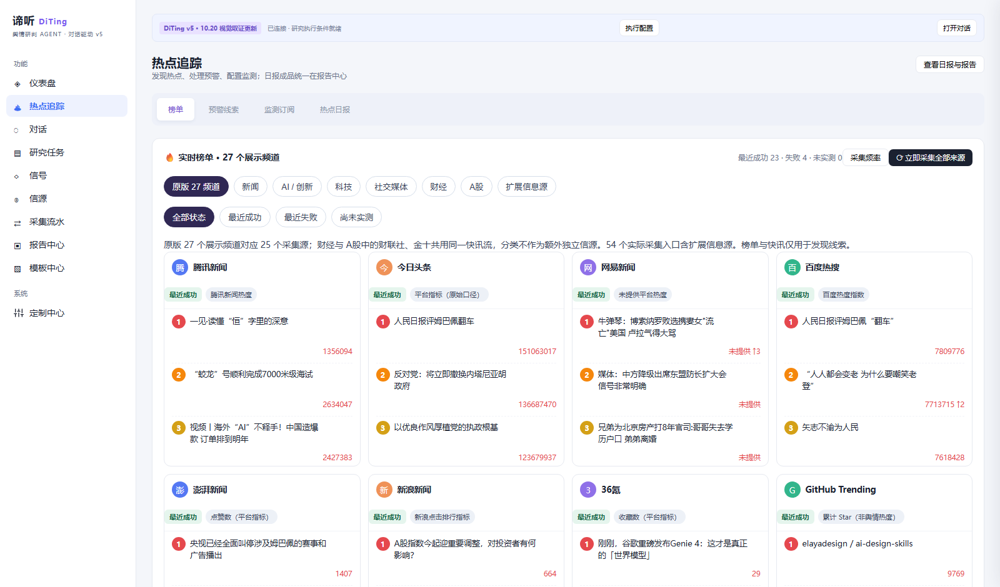
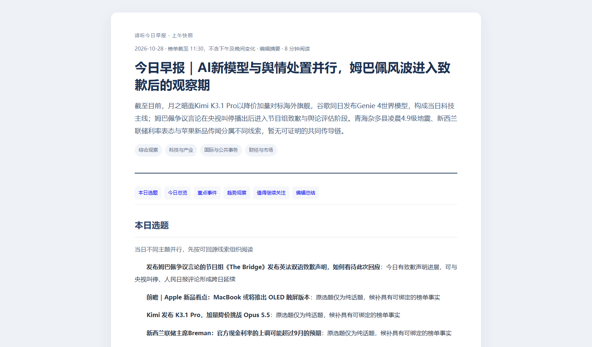
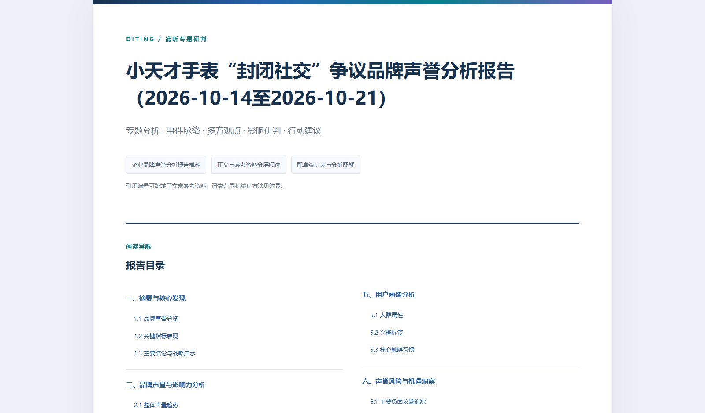
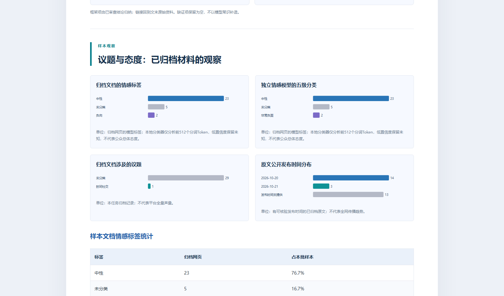

# DiTing

DiTing 是运行在本机的多源热点监测与研究 Agent。它把热点发现、关键词值守、主题日报和多 Agent 深度研判放在同一个控制台；采集记录、研究证据、报告与模型用量保存在本地。

日常使用可以从「热点追踪」发现议题，或在「对话中心」直接提出研究问题。日报按归档榜单选题，再读取和检索公开来源页；深度研究由主 Agent 分配调查、讨论、核验和成稿任务。用户可以在「研究任务」查看过程，在「报告中心」阅读、导出并追问报告。

## 技术栈

| 部分 | 技术 |
| --- | --- |
| 后端与 API | Node.js 24+、TypeScript、Fastify |
| 数据存储 | SQLite（`node:sqlite`） |
| Agent 执行 | dsh TypeScript SDK、原生子 Agent、任务队列与检查点 |
| 网页与平台采集 | TypeScript 采集器、RSS、Playwright、正文抽取 |
| 本地模型 | Transformers.js、ONNX Runtime |
| 前端与导出 | v5 控制台、HTML、Markdown、PDF |
| 质量检查 | TypeScript 类型检查、Node.js Test Runner、GitHub Actions |

## 主要功能

- 采集热榜与 RSS 信息，保存来源状态、原始快照和采集流水；来源失败会如实显示。
- 按主题汇集线索，结合公开网页材料生成日报和早报；支持手动刷新与定时采集。
- 自定义关注关键词，查看分级信号，并按配置推送高优先级线索和日报。
- 由多个子 Agent 协作完成调查、补证、讨论、核验与成稿；研究任务支持预算、审批和断点续跑。
- 管理证据引用、报告模板、可视化与导出，并对已归档报告继续提问。
- 按授权范围使用平台登录态采样；在本机运行情感分类与语义抽样模型。

采集条目、互动指标和情感分类是有界样本，不应直接解释为全网声量或公众总体态度。页面会展示实际来源状态及各任务的证据范围。

## 界面预览

以下为本机运行界面的截图。榜单、日报和报告内容是截图时的归档样本，随采集和任务变化；仓库不包含这些运行数据。

**热点追踪**：按频道查看榜单、来源状态和原始排名。



**今日早报**：从归档热点选题，结合公开来源材料组织多主题阅读稿。



**专题报告**：研究任务完成后的目录与正文阅读页。



**报告图表**：展示本次归档样本的情感标签与发布时间，图中口径说明随图呈现。



## 工作原理

```text
浏览器控制台（127.0.0.1:8090）
          │ 本机 API
          ▼
     Fastify / TypeScript
          │
          ├─ 榜单与 RSS 采集 ──► 原始快照、采集状态 ──► 关键词信号
          │                                      └─► 日报选题
          ├─ 来源页读取与有界检索 ──► 日报材料 ──► 编辑叙事与质检
          └─ 研究任务队列 ──► 主 Agent 编排三引擎与审查 ──► 报告与追问
                                │
                                ▼
                 SQLite：证据、审批、用量、报告、通知流水
```

日报先从已归档热点选题，再在额度内寻找可回源的正文材料；它不启动一轮深度研究。深度报告走独立的任务、预算和证据核验流程。模型和搜索服务需要自行配置，相关调用可能产生费用。

### 深度研究：主 Agent 与三引擎

用户**明确发起新的研判任务**时，主 Agent 先确定研究范围、时间窗、预算和可用工具，然后并行委派三个调查子 Agent：

| 成员 | 主要工作 |
| --- | --- |
| **DiTing Ledger · 档案研析** | 查询本机已归档数据、历史研究与热点，优化检索词，做样本、情感和统计分析 |
| **DiTing Prism · 媒介取证** | 调查公开网页及相关图片、视频线索；需要登录态或平台深采时先走对应审批 |
| **DiTing Trace · 新闻溯源** | 检索新闻与原始报道，梳理事实、时间线、发布主体及相互矛盾的说法 |

三个引擎各自按段落进行首轮查询、总结和反思补查，提交带原文引用的调查结果。**ForumHost** 同时作为旁路主持，滚动读取新摘要、指出分歧与待补线索；调查引擎不必等主持发言才继续。主 Agent 汇总三方结果后，让 **Planner** 检查材料是否充分、**Verifier** 核对事实与引用、**Advocate** 检查反例与过强结论。任一审查未通过，就按缺口定向补证；通过后才委派 **Report** 按所选模板成稿、校验并入库。

```text
明确的研究请求 → 主 Agent 冻结范围、预算与模板
                         │
                         ├─ Ledger（档案研析） ─┐
                         ├─ Prism（媒介取证） ─┼─ 并行调查、逐段反思、归档证据
                         └─ Trace（新闻溯源） ─┘         │
                               ForumHost ← 滚动摘要（旁路，不阻塞调查）
                                                │
                         主 Agent 汇总 → Planner / Verifier / Advocate
                                                │ 未通过：定向补证
                                                ▼ 通过
                                      Report 成稿 → 质检 → 报告入库
```

普通问答直接走对话模型；对已归档报告追问使用该报告的上下文与证据；定时日报走上面的多主题日报链路。**这三种入口不会仅因为出现“研究”或“热点”两个字就自动启动三引擎。**

## 开始使用

### 1. 安装与启动

需要 Node.js 24 或更新版本。克隆仓库后，在项目目录运行：

```powershell
npm ci
Copy-Item .env.example .env
npm run build
npm start
```

打开 <http://127.0.0.1:8090>。`npm start` 在当前终端运行，按 `Ctrl+C` 停止。服务仅监听本机，运行数据默认写入被 Git 忽略的 `data/`。如果不需要覆盖默认配置，可以不创建 `.env`。

Windows 更新代码后，可在项目目录执行 `& .\scripts\restart.ps1 -Background`：脚本先核对现有服务和研究任务，再构建并后台重启；`-CheckOnly` 只检查，不重启。后台运行不等于开机自启。

### 2. 配置所需能力

按需在 `.env` 中修改端口、数据目录和研究执行开关。模型密钥请在控制台的「定制中心」填写，由本机加密保存，不要写进仓库。

| 用途 | 需要配置 |
| --- | --- |
| 热点追踪、已归档内容查看 | 安装并启动服务即可；各来源的可用状态以页面实测为准 |
| 对话与日报叙事 | 在「LLM 模型与路由」配置模型入口、密钥、费率及对应角色 |
| 公开网页补充检索 | 在「Key 与服务」配置并启用搜索供应商 |
| 深度研究 | 配置已构建的 dsh SDK 路径 `DITING_DSH_ROOT`，启用 `DITING_RUNTIME_ENABLED=true`，并为研究角色配置模型路由、费率与预算 |
| 平台登录采样 | 在「Key 与服务」完成对应平台登录；每次深采仍须按范围审批 |
| 消息通知 | 配置通知通道、订阅和监测规则；可先在平台内查看信号与日报 |
| 本地情感分类 | 运行 `npm run sentiment:setup` 和 `npm run sentiment:check`，然后在「Agent 与引擎」启用 |

`DITING_DSH_ROOT` 可指向本机已构建的 SDK 目录；项目也会检查 `vendor/deepseek-harness` 与相邻目录。只使用基础采集和页面时无需启用研究执行。模型与服务的实际连通状态请在控制台检查。

### 3. 使用流程

1. 在「热点追踪」手动更新或设置采集计划，查看各来源的快照与失败状态。
2. 在「信号」添加关注关键词，设置通知；在「日报」阅读已生成的主题汇总。
3. 在「对话中心」提出研究主题、时间范围与预算，可让系统选模板，也可上传或共创模板。
4. 在「研究任务」处理需要的采样审批并查看证据、费用和阶段进度。
5. 在「报告中心」阅读报告，导出 HTML、Markdown 或 PDF；关联报告后可继续追问。

## 定时运行

采集计划由控制台配置，**新安装默认不自动采集**。启用后按北京时间运行：

- 08:00 更新热榜并归档快照。
- 11:30 再次更新热榜，根据截至本轮采集完成的当日快照生成今日早报。
- 23:30 再次更新热榜，根据截至本轮采集完成的当日快照生成今日日报。该日报不会把 23:30 之后未采集的时段称为已覆盖。
- 两版须通过质检才会进入已启用的消息通知队列；来源失败或质检不通过会保留记录。页面手动更新热点不会暗中触发付费日报。

若通知订阅启用了夜间免打扰，23:30 成稿的推送会按免打扰设置延后，报告仍在生成后入库。

调度器随服务进程运行。电脑关机、睡眠或服务未启动时不会按时执行；不能用“已配置计划”代替无人值守和长期稳定性验收。

## 验证

```powershell
npm run typecheck
npm test
npm run build
```

自动测试和 CI 用于检查代码回归；真实来源可用性、研究结论、通知送达与长期稳定性需要分别验收。

## 数据、合规与许可

DiTing 读取公开榜单、RSS、公开来源页，以及用户授权且按任务范围审批的平台样本。**并非所有来源都是官方 API**；公开可见也不等于可以无限制抓取、复制或传播。使用者应遵守适用法律、平台规则、版权及个人信息处理要求，并在分享报告前核对事实、来源和样本边界。

`.env`、`data/` 和真实凭据不提交仓库。运行数据、密钥、采集流水与报告默认留在本机；对外分享时应自行检查并处理敏感内容。

本仓库目前**没有覆盖 DiTing 自有代码的根目录统一 `LICENSE` 文件**，因此不能把其他项目的 MIT 许可链接当成 DiTing 的许可，也不应宣称整个仓库已采用 MIT。第三方代码、模型和模板各有适用条款，见 [第三方许可说明](THIRD_PARTY_NOTICES.md)。若今后决定开放复用授权，应先核对这些组件，再为自有部分添加明确的根目录许可证。
