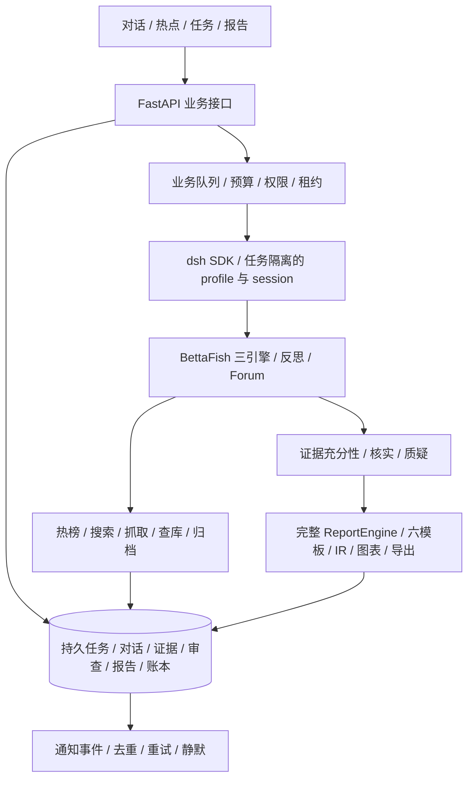

# DiTing 整体实施规划 v6

日期：2026-10-18。实施目录：`D:/Project/DiTing`。本文承接最新产品约定；旧 v3 中与本文冲突的阶段安排不再作为实施依据。

## 一、产品边界

用户在对话中提出研究主题，系统自动理解范围、选模板、创建独立任务；授权与预算范围内完成发现、取证、论坛讨论、核实、质疑、完整成稿。基础问答与报告追问不自动启动取证。需要关键澄清、工具审批或扩大预算时在原对话或关联任务内处理，不再使用第二套研究创建表单。

保留的导航：仪表盘、热点追踪、对话、研究任务、信号、信源、采集流水、报告中心、模板中心、定制中心。仪表盘保留原来的概览、彩色图表、热度、活动流、信号，并追加待处理、重点预警、运行与排队、最新报告四块。信源与采集流水继续作为一级入口。深度报告不是一级功能，研判工作台属于具体任务。

原型中的数字不迁移为正式数据。真实应用保留布局，对尚无输入的图表显示未覆盖/未接入，不画虚构曲线。RSS 已移除；通知使用平台内、飞书、企业微信的明确订阅策略。

## 二、系统如何分工



业务队列负责“哪个研究何时执行”，dsh 负责“任务内部的 Agent loop 和工具调用”；不在网关另造第二套 Agent loop。三引擎、Forum 和 ReportEngine 是业务成员，不因为更换底座而删减。团队插件是否采用第三方 AgentTeams，须在锁定的 dsh 版本上验证；它不是第一版的强制依赖。

逻辑职责按原 7 个编排角色和 5 个引擎职责登记；运行时按任务需要实例化，不将固定 12/13 个进程数量当成能力指标。

## 三、按依赖顺序交付

| 里程碑 | 必须交付 | 通过条件 |
| --- | --- | --- |
| M0 持久控制层 | 任务、对话、排队、状态、审计、原文导入、后端连接前端、执行接口 | 刷新/重启保留；并发请求不重复开任务；同一执行槽不并跑；未接入不伪成功 |
| M1 真实发现与问答 | 服务端模型凭据与路由、普通问答；newsnow/DailyHotApi 适配；原文归档；快照 diff；代码统计 | 用真实响应形成快照与记录；失败可见；热榜排名不当发帖量；样本能复算 |
| M2 dsh 调查闭环 | 锁定 profile、工具白名单、独立 workspace/home/session、三引擎、反思、Forum、有限补证、审批与用量回传 | 两任务串并行隔离；中断后可恢复；审批拒绝不执行；预算/轮次/超时能判停 |
| M3 完整报告闭环 | 六模板、上传/共创、完整 ReportEngine、IR、表格图表质检、HTML/MD/PDF、报告追问 | 原版固定样例回归；全部图表有底表；全部实质断言挂证据；三审和导出通过；新版本不覆盖旧版 |
| M4 自动值守与通知 | 监测订阅、事件归并、自动立题、优先级、每日限额、飞书/企业微信、通知 outbox | 同一事件不反复开任务；报告入库后才通知；重试去重；通知失败不改研究状态 |
| M5 稳定运行 | 连续运行、故障演练、品牌策略、历史相似、多用户规划 | 形成耗时/费用/成功率/审查缺口的真实验收记录 |

这些是依赖与验收边界，不是承诺天数。30–60 分钟报告目标要在固定真实主题集上量测后确定；没有数据覆盖时不得用缩短流程或补造数据满足时限。

## 四、本轮已开始的 M0

代码目录：

```text
diting/
  api.py          同源本地 API 与原型前端挂载
  db.py           SQLite/WAL、业务对象与事务
  service.py      对话路由、任务状态、租约、证据和成稿门禁
  intent.py       第一阶段的保守规则识别，后续替换为可评测结构化意图
  worker.py       业务队列执行槽
  runtime.py      dsh 能力发现与显式 SDK 适配入口
web/live-bridge.js 连接已有 v5 布局，不修改原型参考版
assets/report-templates/ 原版六模板与哈希基线
tests/            并发、恢复、状态、证据和门禁测试
scripts/start.ps1 本地启动
```

数据库保存会话、消息、任务、事件、请求幂等键、原文及哈希、任务证据关联、结论、审查、报告、用量、采集记录、通知 outbox。首次单机使用 SQLite；需要多进程部署时迁移到 PostgreSQL，业务契约不绑定固定表数。

当前服务明确停在 `waiting_runtime`：持久控制层是真实代码，dsh/BettaFish 的联合执行还未认证。不会把本地流程推进当成真实研究，也不会自动调用参考仓库中已配置的密钥。

## 五、任务状态与并发

`queued → running → waiting_runtime / waiting_input / waiting_approval / waiting_evidence / review → completed`，另有 paused、failed、cancelled。

- 每个任务记录独立范围、预算和配置版本；任务补充材料记录为事件。完成或取消后不能改写冻结输入，继续调查创建关联任务。
- 一个完整研究执行槽由数据库事务和唯一约束保证；用户任务优先于尚未执行的自动任务，同类按创建顺序。
- 每次领取任务有独立租约令牌。过期领取重新排队，迟到结果不能改变已暂停或被重新领取的状态。
- API 修改携带 revision，旧页面不能覆盖新状态。
- 对话请求带 request_id，重复提交只创建一次任务，相同编号换内容会冲突。
- 重启恢复的是业务记录与可恢复执行点；dsh 内部会话恢复仍需在 M2 实测，不能仅凭队列恢复声称已实现模型执行恢复。

## 六、dsh 与 BettaFish 的接入办法

本机已定位 dsh 源码：`D:/Study/deepseek_harness/deepseek-harness`，核对版本 `9fcc9f4d6ea6e02ab92ed12bfb2ca627b3363035`。官方 SDK 的调用方式采用 `DeepSeekHarness`、明确 profile、workspace、home 与 session，不使用私有启动参数或猜测 CLI。

适配器将每个任务的 workspace 和 Harness home 放入独立目录，session 使用 task_id。先完成无敏感数据的启动/事件/停止/恢复 spike，再启用受控舆情 profile。通用 SDK 能运行，不等于三引擎工具、审批和领域门禁已经存在。

BettaFish 参考目录：`D:/工作学习/9github项目/agent-code-atlas-output/repos/BettaFish`。该目录目前没有 Git 元数据，采用文件哈希记录源码快照。已复制六份原版模板到项目资产目录，未读取/复制其 `.env` 凭据，也未改动参考仓库。完整引擎后续在隔离进程中接入，避免全局日志、Forum 文件与输出目录串任务。

重点保持：三引擎的搜索、反思与抽样 → Forum 主持与反馈 → 报告模板选择、切片、布局、篇幅、逐章写作、IR、图表表格校验和 HTML/MD/PDF。参考源码入口和哈希见 `source-inventory-2026-10-18.json`。

## 七、真实数据和质量约束

- 原文有来源、内容哈希、取得时间和来源类型；用户导入不标为联网抓取。
- 共享归档允许去重，但任务关联分开；引用必须来自该任务的原文片段。
- 三审绑定 evidence_revision 与 claims_hash；追加证据或结论使旧审查失效。成稿状态变更与通知入队在同一事务。
- 三审记录目前仅为内部执行器契约，不提供前端“一键通过”接口；真实判定、图表底表和完整 IR 验证在 M2/M3 接入。
- 模型负责解释与提出判断；数字由代码对明确样本统计。外部声称、实际采样、派生指标、估算、缺失分别标注。
- 费用按供应商回传；缓存属于输入的一部分，失败/重试分次记录；未知用量和未知费用不当作零。

## 八、通知与配置

信号产生/升级、待审批、必要信息缺失、预算告警、重试耗尽失败、报告入库完成、报告更新及定时汇总是通知事件。普通采集成功和成员发言只记日志。飞书/企业微信的真正发送须有明确订阅范围、凭据、去重、静默与重试；M0 只有 outbox 数据契约，不发送消息。

服务端配置分为公开元数据、密钥引用、模型路由、执行 profile 和策略版本。前端不保存真实密钥；原型配置卡片暂明确标为未接入，不把内存草稿说成已经落库。

## 九、验收方式

本轮自动测试覆盖：普通问答不建任务、刷新/重开数据库保留、重复请求幂等、并发单槽、过期租约恢复及迟到回调拦截、暂停与 revision、无运行时诚实等待、证据去重与任务隔离、三审与证据变更、结论变更、缓存费用、父任务关联、API 校验与同源写入、取消后成稿拒绝。

浏览器验证使用明确标注的验收任务与材料；不是一次真实舆情调查。真正研究验收还需实际主题、来源、原文、统计底表、三引擎与论坛记录、审查记录、完整报告、导出文件、逐角色账本以及耗时结果。

## 十、依据

- [DeepSeek Harness 官方仓库](https://github.com/deepseek-ai/deepseek-harness)
- [官方 Python SDK 使用说明](https://github.com/deepseek-ai/deepseek-harness/blob/master/docs/user/guide/python-sdk.md)
- 本地 BettaFish 源码静态检查与六模板快照；未对其当前在线服务可用性作出结论。

官方项目仍提示开发预览状态与兼容性变化，因此接入按本机固定版本认证，不依赖浮动的最新版本。
