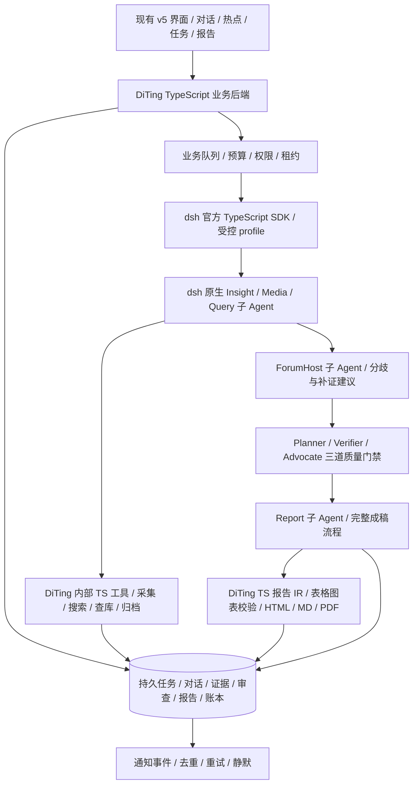

# DiTing 整体实施规划 v6

日期：2026-10-18。实施目录：`D:/Project/DiTing`。本文承接最新产品约定；旧 v3 中与本文冲突的阶段安排不再作为实施依据。

当前交付对照与未完成项统一记录在 [预期对齐审计与开发清单](预期对齐审计与开发清单-2026-10-18.md)。本文中“Python 基线/四源”等是阶段快照，不能作为当前版本完成状态；目标效果仍按本文和用户最新确认的 v5 布局实施。

本次修订：确定 **TypeScript 主后端、dsh 原生子 Agent、后端内部采集模块、BettaFish 功能思路的独立实现**。以下区分现有代码和目标设计，不能将规划写成已实现能力。保留个人单机项目的规模，不提前建设分布式微服务。本文修订不等于已经完成语言迁移。

## 一、产品边界

用户在对话中提出研究主题，系统自动理解范围、选模板、创建独立任务；授权与预算范围内完成发现、取证、论坛讨论、核实、质疑、完整成稿。基础问答与报告追问不自动启动取证。需要关键澄清、工具审批或扩大预算时在原对话或关联任务内处理，不再使用第二套研究创建表单。

保留的导航：仪表盘、热点追踪、对话、研究任务、信号、信源、采集流水、报告中心、模板中心、定制中心。仪表盘保留原来的概览、彩色图表、热度、活动流、信号，并追加待处理、重点预警、运行与排队、最新报告四块。信源与采集流水继续作为一级入口。深度报告不是一级功能，研判工作台属于具体任务。

原型中的数字不迁移为正式数据。真实应用保留布局，对尚无输入的图表显示未覆盖/未接入，不画虚构曲线。RSS 已移除；通知使用平台内、飞书、企业微信的明确订阅策略。

## 二、系统如何分工



业务队列负责“哪个研究何时执行”，dsh 负责“任务内部的 Agent loop、原生子 Agent 和工具调用”。Insight、Media、Query、ForumHost、Report 都是 dsh 中真实创建的子 Agent，分别配置角色提示、模型路由、工具范围、结构化产出和预算；它们不是前端五张卡片，也不是转发到 BettaFish HTTP 服务的五个按钮。

主 Agent 组织调查、收集证据和调度补证。Planner 判断覆盖是否充分，Verifier 核对事实与引用，Advocate 检查反例和结论强度。需要补证时回到指定调查成员，门禁通过后才进入正式成稿。运行时可以先产生待审草稿，但草稿不作为通过审查的报告交付。

dsh 原生 subagent 机制是必需项；本机还存在实验性 agent-team 能力，mailbox/团队任务板是否使用它，要在固定版本验证后决定。第三方 AgentTeams 不是强制依赖，产品不依赖一个未经验证的第三方团队插件。

逻辑职责按原 7 个编排角色和 5 个引擎职责登记；运行时按任务需要实例化，不将固定 12/13 个进程数量当成能力指标。

### 语言和运行边界

采用 dsh 不强制业务后端使用 TypeScript；Python SDK 本来也能驱动 dsh。针对本项目仍处于早期、用户希望自行实现核心功能、dsh 与两套热榜项目主要使用 TS/Node 的情况，目标选择 **TypeScript 作为业务后端和 Agent 插件的主要语言**，减少跨语言边界。

| 部分 | 目标语言及实现 | 当前情况 |
| --- | --- | --- |
| 界面 | 保留 v5 的 HTML/CSS/JavaScript，新增业务代码逐步采用 TS | 已有原型与连接脚本，不为换语言重做页面 |
| 业务后端 | Node.js + TypeScript；统一任务、配置、证据、报告与账本业务 | 当前为 Python/FastAPI，待迁移 |
| Agent 底座 | 官方 dsh Runtime，按锁定版本运行 | 有本地源码，领域 profile 未认证 |
| 五引擎角色 | dsh 原生子 Agent，TS 插件与角色配置 | 目前是目标设计，未完成运行接入 |
| 热榜、搜索、归档、统计 | DiTing 内部 TS 模块，直接函数调用 | 现有热榜代码仍为调用本机服务的 HTTP 试验实现，待替换 |
| 报告生成 | Report 子 Agent + 自建 TS 报告流程、IR、校验与渲染 | 尚未实现完整交付 |
| Python 能力 | 仅在确实需要现成聚类、情感模型等库时作为可选本机 worker | 首版不以完整 BettaFish Python 进程为必需依赖 |

全用 TS 也不表示必须全在同一进程：业务服务可用官方 TypeScript SDK 通过 stdio JSON-RPC 启动 `dsh`，领域 TS 插件加载到该 runtime 内。遵循官方 profile/插件启动边界，不直接拼装私有 agent-loop 入口。内部 TS 工具直接调用共享业务模块；不启动 NewsNow、DailyHotApi、BettaFish 的独立 HTTP 服务。访问原始网站、模型、搜索供应商和发送订阅通知仍然需要网络。

## 三、按依赖顺序交付

| 里程碑 | 必须交付 | 通过条件 |
| --- | --- | --- |
| M0 持久控制层 | 任务、对话、排队、状态、审计、原文导入、后端连接前端、执行接口 | 刷新/重启保留；并发请求不重复开任务；同一执行槽不并跑；未接入不伪成功 |
| M0.5 TS 迁移与 dsh 启动验证 | 业务契约清单、TS 工作区、API/数据库行为迁移；自定义领域 profile 的最小原生子 Agent 调用 | 保留对话/任务/原文；并发与幂等回归；原生子会话真实出现；启动、事件、取消和退出通过 |
| M1 真实发现与问答 | 服务端模型凭据与路由、普通问答；内部 TS 热榜采集模块；原文归档；快照 diff；代码统计 | 不启用两套热榜 HTTP 服务也可直接采集原始平台；来源状态可见；排名不当讨论量；样本能复算 |
| M2 dsh 调查闭环 | 五引擎中前三个调查成员与 ForumHost；Planner/Verifier/Advocate；专用工具、有限反思补证、审批与用量回传 | 各成员有独立子会话/工具范围/结构化成果；任务隔离；超时/预算能判停；门禁失败能有界补证或诚实交付缺口 |
| M3 完整报告闭环 | Report 原生子 Agent；自建完整报告流程、六类自有模板、上传/共创、IR、表格图表、HTML/MD/PDF、报告追问 | 固定主题与证据样本回归；图表有底表；实质断言挂证据；三审和导出通过；新版本不覆盖旧版 |
| M4 自动值守与通知 | 监测订阅、事件归并、自动立题、优先级、每日限额、飞书/企业微信、通知 outbox | 同一事件不反复开任务；报告入库后才通知；重试去重；通知失败不改研究状态 |
| M5 稳定运行 | 连续运行、故障演练、品牌策略、历史相似、多用户规划 | 形成耗时/费用/成功率/审查缺口的真实验收记录 |

这些是依赖与验收边界，不是承诺天数。30–60 分钟报告目标要在固定真实主题集上量测后确定；没有数据覆盖时不得用缩短流程或补造数据满足时限。

## 四、已有代码与迁移现状

当前实际代码目录（Python 基线，不能当成 TS 已完成目录）：

```text
diting/
  api.py          同源本地 API 与原型前端挂载
  db.py           SQLite/WAL、业务对象与事务
  service.py      对话路由、任务状态、租约、证据和成稿门禁
  intent.py       第一阶段的保守规则识别，后续替换为可评测结构化意图
  worker.py       业务队列执行槽
  runtime.py      dsh 能力发现与显式 SDK 适配入口
web/live-bridge.js 连接已有 v5 布局，不修改原型参考版
assets/report-templates/ 已复制的六份上游模板，待来源审查/独立替换
tests/            并发、恢复、状态、证据和门禁测试
scripts/start.ps1 本地启动
```

数据库保存会话、消息、任务、事件、请求幂等键、原文及哈希、任务证据关联、结论、审查、报告、用量、采集记录、通知 outbox。首次单机使用 SQLite；需要多进程部署时迁移到 PostgreSQL，业务契约不绑定固定表数。

当前服务明确停在 `waiting_runtime`：持久控制层是真实代码，dsh/BettaFish 的联合执行还未认证。不会把本地流程推进当成真实研究，也不会自动调用参考仓库中已配置的密钥。

M1 另有 `diting/hotlists.py`、快照表及接口测试，但其实现仍请求本机 NewsNow/DailyHotApi HTTP 服务，只是早期试验，不符合本次确认的内部模块方案，也不构成原生采集已经完成。迁移期间保留可运行基线与数据，TS 版本通过验收后再切换，不通过改扩展名或修改页面文案声称迁移完成。

## 五、任务状态与并发

`queued → running → waiting_runtime / waiting_input / waiting_approval / waiting_evidence / review → completed`，另有 paused、failed、cancelled。

- 每个任务记录独立范围、预算和配置版本；任务补充材料记录为事件。完成或取消后不能改写冻结输入，继续调查创建关联任务。
- 一个完整研究执行槽由数据库事务和唯一约束保证；用户任务优先于尚未执行的自动任务，同类按创建顺序。
- 每次领取任务有独立租约令牌。过期领取重新排队，迟到结果不能改变已暂停或被重新领取的状态。
- API 修改携带 revision，旧页面不能覆盖新状态。
- 对话请求带 request_id，重复提交只创建一次任务，相同编号换内容会冲突。
- 重启恢复的是业务记录与可恢复执行点；dsh 内部会话恢复仍需在 M2 实测，不能仅凭队列恢复声称已实现模型执行恢复。

## 六、dsh 与 BettaFish 的接入办法

### 6.1 角色实现与源码复用是两件事

BettaFish 用来研究功能分工和报告完整性；DiTing 按自己的业务规格、数据模型和 dsh 工具约定重新设计实现。目标从“完整 Python 引擎原样搬入”调整为“保留功能目标，在 dsh 中独立实现”。这不等于已经达到 BettaFish 原版报告质量，功能保留需要逐项验收。

| 原生子 Agent | 在 DiTing 中实现的能力 | 授权工具与结构化产出 |
| --- | --- | --- |
| Insight | 已采集数据检索、样本分析、趋势、聚类/情感结果解释 | 只读查询、统计；返回样本范围、证据 ID、底表 ID 和缺口，不自行编数 |
| Media | 外部网页/公开内容调查及有条件的多模态理解 | 搜索、归档、受审批约束的关键词深爬；返回原文、时间、媒体素材及证据 ID；无对应模型能力时明确缺失 |
| Query | 带时间范围的新闻搜索、事实核对与时间线 | 新闻检索、抓取、交叉来源核对；区分原发/转载，返回事件时间和来源关系 |
| ForumHost | 汇总三方发现、识别重复和矛盾、建议补证 | 读本任务成员成果和证据；写结构化讨论记录；不凭主持结论创造新事实 |
| Report | 模板选型、材料组织、布局与篇幅规划、逐章写作、修订 | 只读已批准材料，调用报告 IR/表格图表校验/渲染工具，输出带版本的报告草稿与文件 |

每个角色有独立 persona、允许工具清单、模型路由、结构化输出、token/时间/轮次预算以及对应的 task_id / child_session_id。dsh 原生 subagent 服务、进程内 spawn 提供方、委派与控制工具在领域 profile 中显式组合；按角色显式限制工具，不能假定父级工具限制自动完整继承。需要补证和后续消息的调查成员使用可继续会话；单次检查可使用一次性子会话。

主 Agent 接收的成果必须包含可查询的证据 ID、底表/产物引用和缺口，不能只拿到一段摘要。成员中间进度由子会话事件/领域产物记录投影到任务页；会话持久化、业务证据和业务审查分别保存，不能把内部推理文本当成证据链。

保留的业务步骤是：三引擎取证与有限反思 → Forum 主持与反馈 → 三道门禁 → 模板选型 → 证据切片 → 布局规划 → 篇幅规划 → 逐章写作 → 结构与图表修复 → IR 装配校验 → HTML/Markdown/PDF 渲染。成稿各阶段有可恢复产物和失败原因，不把一次模型长回答等同于完整 ReportEngine 功能。具体阶段划分按 DiTing 自行设计，不承诺原版源码/提示词逐字一致。

### 6.2 后端内部采集与工具

NewsNow、DailyHotApi 的价值在于各平台抓取和解析逻辑。取得完整源码并固定版本后，选择可复用模块并保留适用的 MIT 版权/许可说明，剥离它们的 UI、HTTP 路由和原有服务缓存，整理为 DiTing 的 TS 采集函数；依赖服务框架的函数需要重构后才能直接 import，不能假定路由文件就是可调用库。

采集模块直接访问原始平台，统一输出来源、平台、条目 ID、标题、URL、排名、原始热度及单位、取得时间、原始响应和错误类别。双项目采到同一条内容时保留采集实现的出处，但合并重复事件；两个实现读到同一上游榜单不算两份独立事实证据。

定时采集/diff/入库由确定性调度代码执行，不需要每个采集 tick 都启动完整 Agent 团队。热度跃升仅对同来源、同指标、同单位和可比窗口计算：`(当前值 - 基准值) / 基准值 >= 2` 表示增长至少 200%，基准值须大于 0。只有排名、零基准或指标缺失时用“新入榜/排名上升”等规则，不能虚构增长百分比。

领域工具使用 `hotlist.snapshot`、`search.web`、`fetch.scrape`、`db.ro_query`、`evidence.archive`、`chain.write`、`push.notify`、`crawl.deep` 等语义名称；实际注册名和 schema 以锁定 dsh 版本验证为准。工具代码位于 DiTing，权限、审批、预算和取消信号通过 dsh 工具流水线实施。配置好的外部供应商仍可联网调用；默认发现链路不依赖 NewsNow/DailyHotApi 的 MCP 或 HTTP 服务。通知只按已授权订阅发送。

本地 NewsNow 参考目录目前主要是构建产物，DailyHotApi 参考目录为空，不能把“本地路径存在”算成源码就位或 27 源已重新验收。关键词深爬也必须实现或集成实际抓取功能，热榜本身不能替代它；MediaCrawler 等候选要单独核对源码、许可、平台支持、登录依赖及审批，再选必要部分，不能默认拿来即用。

### 6.3 Python 与 TypeScript 如何处理

原有 Python 业务功能按接口和数据行为重建为 TS：任务状态、幂等、租约、证据去重、审查版本、报告与 outbox 事务都需要迁移。BettaFish 的角色策略、提示词和报告流程按领域需求重新设计为 dsh 角色配置与 TS 功能；不是用工具把 `.py` 机械转换成 `.ts`。

首版的计数、比例、时间窗口、榜单 diff、表格与图表底表都由 TS 计算。需要情感模型、聚类等特定 Python 库时，再添加项目自有 Python worker，经本机 stdio 交换带版本的 JSON 请求/结果，传递文件引用；限定操作名、参数、预算和取消方式，不给模型任意 shell 拼接入口。这是可选的内部执行边界，不是单独部署 BettaFish HTTP 服务，也不是一个额外的研究 Agent 主循环。

首版默认路径不需要 Python/TS 来回通信；确有库依赖时才增加。不要为了“语言统一”重新实现成熟模型库，也不要为了保留 Python 引擎而启动两套独立 Agent loop。

### 6.4 dsh 的固定版本与真实启动

本机 dsh 源码：`D:/Study/deepseek_harness/deepseek-harness`，先前核对版本 `9fcc9f4d6ea6e02ab92ed12bfb2ca627b3363035`。实施时重新校验 commit 与构建/包版本并记录；不能根据浮动在线文档猜测本机能力。

TS 业务服务通过官方 TypeScript SDK 的实际公开 API 启动正常 `dsh` 入口；示例中的 Python `DeepSeekHarness` 只属于现有 Python 基线，不作为 TS 目标 API。每个研究隔离 workspace、Harness home、root session 和业务产物目录，子会话映射到对应 task_id。先验证启动、握手、子 Agent 创建、事件、取消、退出，再验证重启后业务与 Agent 会话的恢复边界。

领域 profile 必须显式包含原生子 Agent、所需工具及 guard 等能力。SDK 启动成功或最小示例能返回文本，不代表团队、门禁和领域工具已经存在；尤其不能把不含 subagent 的最小 profile 原样当成研究 profile。

### 6.5 个人学习、独立实现与上游许可

个人学习一般可以研究设计思想和原理；思想/处理过程与具体代码、文档表达不是同一回事。《计算机软件保护条例》第六条、第十七条分别涉及这种区分和学习研究用途。本文是实施路线判断，不对具体实现作“不可能侵权”的法律保证。

| 使用方式 | 本项目处理原则 |
| --- | --- |
| 研究三引擎、反思、主持、报告等一般思路，依照自身需求自行设计代码 | 作为默认路线，记录借鉴来源；用功能验收衡量，不复制独特实现和大段表达 |
| 复制 BettaFish 源码、提示词、模板、静态资产或对源码逐行改写/跨语言翻译 | 按实际来源和适用许可处理，不能仅因换成 TS、改变量名或由 AI 改写就称为原创 |
| 仅在自己电脑运行/修改 GPL 程序 | GPL 一般不因私人修改就要求向公众发布源码；具体第三方组件另查许可 |
| 将含上游材料的项目公开到 GitHub 或交付他人 | 不能仅以“个人项目/不收费”为由免除适用的分发和署名等义务，逐项确认许可 |
| 复用 MIT 的 dsh、NewsNow、DailyHotApi 等项目材料 | 保留要求的版权/许可声明，登记来源版本、修改和范围，附带依赖也需核对 |

BettaFish 参考目录为 `D:/工作学习/9github项目/agent-code-atlas-output/repos/BettaFish`，其中许可证文本及第三方组件需要按材料核对。项目已经复制六份原版报告模板；`docs/source-inventory-2026-10-18.json` 的哈希清单只是出处记录，不等于授权书。该清单保留为历史记录，不能删除出处后宣称独立开发。

目标正式模板采用自行编写的六类报告骨架，维持品牌声誉、竞争格局、日常监测、政策行业、公共热点、危机事件的业务覆盖；不要求沿用上游原文。现有复制模板在迁移阶段标为来源待审，不进入新的默认发布包，后续选择合规保留或独立替换，不能把改文件名当成处理许可。如果已有公开版本包含上游材料，也需核查对应版本，后续替换不自动消除既有分发义务。本轮不改项目整体许可证，也不作推送。

### 6.6 建议代码目录与迁移顺序

以下是目标结构，不表示目录均已建立：

```text
apps/server/             TS 业务 API、队列、配置、用量与通知 outbox
packages/domain/         任务/证据/审查/报告业务规则及持久化
packages/collectors/     TS 原始平台采集、解析、归一化与快照 diff
packages/dsh-diting/     dsh 领域插件、原生成员、工具与门禁接线
packages/reporting/      自建报告 IR、统计底表、图表与导出
profiles/diting/         受控 profile、角色权限和模型路由
assets/report-templates/ 六类自有骨架；替换前先处理现有上游材料
workers/python/         可选，确有库依赖后才建立
diting/                 现有 Python 基线，TS 验收前保留
web/                    已确认的界面及业务连接
```

迁移步骤：冻结现有 API/数据库契约和行为样本 → 备份原数据库与文件（SQLite 使用一致性备份或停服务复制，包含 WAL 相关处理）→ TS 实现对话/任务/证据/门禁/账本 → 在数据库副本验证迁移与回滚 → TS SDK 与原生子 Agent spike → 接入原生采集 → 完成研判与成稿 → 切换启动脚本。

验证期间旧 Python 与新 TS 不同时写生产数据库；对话、任务 ID、时间、证据哈希和报告版本必须保留，密钥引用不能变成明文导出。旧进程与新进程只选一套正式运行，TS 通过后再决定旧文件归档/删除。数据库一致性、真实功能验收和通知隔离未通过前，不推送为开发完成版本。

## 七、真实数据和质量约束

- 原文有来源、内容哈希、取得时间和来源类型；用户导入不标为联网抓取。
- 共享归档允许去重，但任务关联分开；引用必须来自该任务的原文片段。
- 三审绑定 evidence_revision 与 claims_hash；追加证据或结论使旧审查失效。成稿状态变更与通知入队在同一事务。
- 三审记录目前仅为内部执行器契约，不提供前端“一键通过”接口；真实判定、图表底表和完整 IR 验证在 M2/M3 接入。
- 模型负责解释与提出判断；数字由代码对明确样本统计。外部声称、实际采样、派生指标、估算、缺失分别标注。
- 费用按供应商回传；缓存属于输入的一部分，失败/重试分次记录；未知用量和未知费用不当作零。
- 反思与补证同时受轮次、耗时、token、抓取量和预算约束；无新增证据时结束或申请扩大范围。证据不足可形成明确标注缺口的受限结论，不能无限循环或把缺口当通过。
- 外部网页和原文作为不可信资料，不得变成子 Agent 的权限指令；来源 URL、时间、引用片段、内容哈希、底表和版本可回溯。

## 八、通知与配置

信号产生/升级、待审批、必要信息缺失、预算告警、重试耗尽失败、报告入库完成、报告更新及定时汇总是通知事件。普通采集成功和成员发言只记日志。飞书/企业微信的真正发送须有明确订阅范围、凭据、去重、静默与重试；M0 只有 outbox 数据契约，不发送消息。

服务端配置分为公开元数据、密钥引用、模型路由、执行 profile 和策略版本。前端不保存真实密钥；原型配置卡片暂明确标为未接入，不把内存草稿说成已经落库。

## 九、验收方式

现有 Python 基线测试覆盖：普通问答不建任务、刷新/重开数据库保留、重复请求幂等、并发单槽、过期租约恢复及迟到回调拦截、暂停与 revision、无运行时诚实等待、证据去重与任务隔离、三审与证据变更、结论变更、缓存费用、父任务关联、API 校验与同源写入、取消后成稿拒绝。现有 HTTP 热榜测试只验证早期服务调用方案，不能冒充内部采集验收。

TS 迁移新增验收：已有数据往返一致；API 行为对齐；任务/证据/审查/outbox 事务和并发不变；dsh 五角色真实子会话、各自工具边界、模型路由及用量可见；补证能回到原成员；失败取消后无迟到写入；原始平台采集成功或失败如实归档。未新增运行实现前，不能声称这些验收已经通过。

报告验收以固定真实证据集和功能检查表为准，不用与 BettaFish 输出逐字相同作为目标。至少交付范围与摘要、事实时间线、样本与方法、平台分布、观点分歧、风险、建议、统计表/图、局限和来源附录；图表由底表生成，引用和数字可复算。多模态、关键词深爬、六类模板、上传/共创、HTML/MD/PDF 分项记录支持范围，不用“保留完整能力”一行文案代替证据。

浏览器验证使用明确标注的验收任务与材料；不是一次真实舆情调查。真正研究验收还需实际主题、来源、原文、统计底表、三引擎与论坛记录、审查记录、完整报告、导出文件、逐角色账本以及耗时结果。

## 十、依据

- [DeepSeek Harness 官方仓库](https://github.com/deepseek-ai/deepseek-harness)
- [官方 SDK 家族与 TypeScript 客户端边界](https://github.com/deepseek-ai/deepseek-harness/blob/master/packages/sdk/README.md)
- [官方原生子 Agent 角色、工具与模型配置](https://github.com/deepseek-ai/deepseek-harness/blob/master/packages/subagent/tool-subagent/README.md)
- [官方 profile 与 bundle 机制](https://github.com/deepseek-ai/deepseek-harness/blob/master/packages/bundle/README.md)
- [BettaFish 源码及许可证](https://github.com/666ghj/BettaFish/blob/main/LICENSE)
- [NewsNow MIT 许可](https://github.com/newsnext/newsnow/blob/main/LICENSE)；[DailyHotApi MIT 许可](https://github.com/imsyy/DailyHotApi/blob/master/LICENSE)
- [《计算机软件保护条例》：第六条及第十七条](https://www.cac.gov.cn/2013-02/08/c_12648744.htm)
- [GNU GPL FAQ：私人修改与是否要求公开源码](https://www.gnu.org/licenses/gpl-faq.html#GPLRequireSourcePostedPublic)
- 本地源码静态检查与模板哈希只用于出处和实现差距分析；不是授权结论，也不是领域运行验收。

官方项目仍提示开发预览状态与兼容性变化，因此接入按本机固定版本认证，不依赖浮动的最新版本。

---

## 2026-10-18 执行进度补记

上文第四节中“当前实际代码为 Python 基线”“TS 迁移待开始”等内容，是规划撰写时的旧状态快照，现已被 [TS 实施与验收记录](TS-实施与验收-2026-10-18.md) 覆盖。后续判断以实施记录中的代码路径和本机验收为准：TS 控制后端、Anthropic 模型协议、dsh 合成子 Agent 运行、四个原生热榜解析器和报告 IR 已有实现；真实主题的研究报告质量、完整平台覆盖与长期运行仍未验收。
