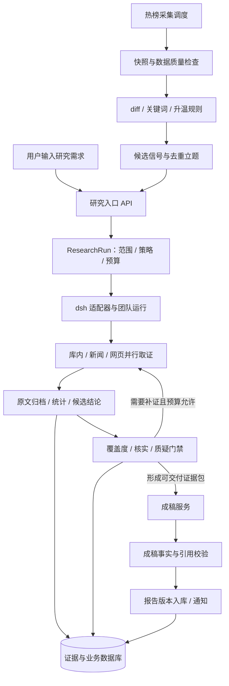

> **2026-10-17 v4 修订：完整报告为核心交付。** 用户明确要求保留 BettaFish 的三引擎、反思、Forum 多轮讨论、六套模板、完整 ReportEngine 与 HTML/MD/PDF。以下内容已按此调整；具体验收以《BettaFish功能保留与完整报告验收-v4.md》为准。当前为方案与交互原型，后端迁移尚待实施。

# DiTing 舆情 Agent 项目规划书

版本：v3 · 架构修订与实施基线  
日期：2026-10-17  
适用范围：单机部署、单团队使用、公开信息研究；后续扩展为多人服务。  
文档状态：建议实施基线。本文中的设计、默认参数、工期和验收目标，不代表系统已经实现或已经达到这些指标。

## 1. 项目定位与本次修订结论

DiTing 是以议题为中心的舆情监测与证据研判系统。系统持续采集热榜发现线索，也接受用户直接输入研究主题；在预设权限和预算内组织调查、核实、质疑和成稿，交付可以回溯到原文的研究结果。

目标体验：用户输入一次研究需求，系统展示执行范围和进度，自动完成可执行的步骤；遇到需要审批的采集操作时保存进度并暂停相关任务；证据不足时交付有明确缺口说明的阶段结果。

项目核心能力确定为四项：

1. 持续发现：定时采集、增量识别、升温判断、去重立题。
2. 可恢复研究：并行取证、持久状态、有限补证、取消与恢复。
3. 可执行质量控制：结构化审查、程序门禁、版本绑定、失败阻断。
4. 结论级追溯：结论连接原文片段、快照和统计口径，成稿后重新校验。

BettaFish 已经具备三引擎并行、论坛协作和报告生成。DiTing 的差异化表述调整为：**在已有研究能力之上，构建持续值守、可恢复执行和结论级证据治理的产品。**

### 1.1 本次规划依据与事实边界

| 信息 | 当前采用的状态 | 实施前需要补充的证据 |
|---|---|---|
| 27 源已实测、规划扩展至 52 源 | 用户提供的已有验证结果 | 源清单、测试时间、响应样本、连续运行记录 |
| BettaFish 三引擎、六套模板、ReportEngine | 上轮对本地源码的静态核对结果 | 迁入后的版本清单、适配测试 |
| HTML 中的模型、连接状态和工具面板 | 产品设计要求 | 实际接口响应、配置加载结果和运行记录 |
| dsh 与第三方 AgentTeams 能力 | 官方/项目文档确认存在相应机制，见第 17 节 | 锁定版本后的本机接入验证 |
| 已配置的模型与 LiteLLM 路由 | 用户提供的环境现状 | 精确模型 ID、工具调用、流式输出、用量回传测试 |
| 当前工作区 | 本规划写入 D:/Project/DiTing/docs | 参考仓库与服务需在实施时登记实际可访问位置 |

此前提供的桌面参考路径在本轮文件读取中不可用，因此本轮没有重新执行这些仓库的本地验证。本文承接上轮静态审查结论，并对 dsh 等公开原始文档重新核查；服务可用性和端到端性能仍列为待验收。

## 2. 原方案应如何修改

| 原方案 | 新规划 | 修改原因 |
|---|---|---|
| P0 先建表、补 key、复制提示词 | P0 先做 dsh 接入与恢复验证，再冻结接口和数据约束 | 先消除底座适配风险 |
| 循环直到证据够 | 时间、工具次数、补证轮数和预算共同约束 | 保证结束，允许诚实交付缺口 |
| 12/13 个角色作为独立成员 | 首版 6 类研究角色 + 成稿服务 + 值守任务 | 职责保留，减少重复调度和上下文 |
| 13 个提示词文件一字不改 | 保留原版供对照，运行版适配工具契约和结构化输出 | 工具名、状态和返回结构已发生变化 |
| 每 15 分钟由 Agent 刷热榜并判定 | 程序完成采集和数值判定，必要时由模型做语义复核 | 节约调用，便于重放与审计 |
| 热度跃升 ≥200% | 明确定义增长率、时间窗、基线、数据新鲜度和小基数规则 | 避免口径不明与假升温 |
| 每条报告挂 URL | 每条实质性事实断言挂结论 ID，结论连接证据片段和归档快照 | URL 可达不等于支持该结论 |
| 三道门禁由角色提示词保证 | 模型提出审查意见，程序验证后改变状态 | 防止靠一句“通过”解锁成稿 |
| token-meter 直接作为账单 | 上下文估算与供应商实际用量分账记录 | 测量值与实际计费用途不同 |
| 固定 11 张表 | 按采集、运行、证据、交付四类业务对象设计 | 必须覆盖恢复、版本和审查记录 |
| 八个支撑页面并行建设 | 先完成研究工作台、报告详情、源/采集管理和必要配置 | 首先让核心流程可用、可验收 |
| 飞书既在 P1 又在 P3 | P1 完成基础预警；P3 增加订阅与复杂推送策略 | 消除阶段边界冲突 |
| 一句话保证全流程无人介入 | 授权范围内自动运行，审批与登录失效时进入可恢复等待 | 与深爬审批约束保持一致 |

## 3. 产品范围与版本边界

### 3.1 第一版必须交付

- newsnow 与 DailyHotApi 双接入，统一源标识、快照、健康状态和新鲜度。
- 分钟级采集调度、diff、关键词监控、升温候选、议题去重与基础飞书预警。
- 一句话发起研究，显式记录主题、时间范围、平台范围、模板和预算。
- 协调者拆题；库内、新闻、网页三路研究并行；核实与质疑；有限补证。
- 原文归档、结论与证据关联、代码统计结果、结构化审查。
- HTML/Markdown 报告入库，报告状态、证据跳转、版本记录和运行摘要。
- 超时、失败、等待审批、取消和重启恢复的明确行为。
- 基础调用用量与成本记录。

### 3.2 后续增强

模板共创、历史相似、品牌监测、复杂订阅、多用户权限和完整仪表盘。PDF、六套模板认证、上传模板及 Forum 多轮研究纳入 P2 核心验收。

六套模板全部迁入并逐套完成真实输入、章节、图表与导出验收。单模板联调可以作为内部里程碑，不能代表完整版本验收。

### 3.3 自动化边界

| 操作 | 默认行为 |
|---|---|
| 公开热榜与已配置公开网页读取 | 在白名单、频率和预算内自动执行 |
| 创建研究任务、内部草稿入库 | 自动执行，保留触发原因和任务 ID |
| 登录态深爬、超出既定采集策略 | 请求审批；暂停相关子任务，允许其他支路继续 |
| 预先配置的飞书基础预警 | 自动推送，执行去重和频率限制 |
| 对外发布完整报告或扩大发送范围 | 独立发布流程，由使用者配置审批要求 |

用户只需输入一次主题，指的是无需手动指挥各研究成员；审批请求属于可见的执行状态，不承诺自动消除验证码、登录失效或平台访问限制。

## 4. 总体架构与职责归属



### 4.1 四个平面

| 平面 | 技术方向 | 负责的状态 |
|---|---|---|
| 采集平面 | Python 调度与采集适配器 | 采集批次、源健康、快照、重试、游标 |
| 研究执行平面 | dsh + 选定的一套团队机制 | 成员、成员任务、依赖、消息、执行尝试 |
| 业务与证据平面 | FastAPI + 数据库 + 对象归档 | 研究运行、结论版本、证据、门禁、报告 |
| 产品平面 | Vue3 + Vite，图表按实际需要接入 | 输入、进度、证据查看、配置和交付 |

### 4.2 防止出现两套互相竞争的调度器

- 采集调度器只负责采集时间表、采集任务和候选立题。
- dsh 团队机制负责研究成员任务的派发与依赖调度。
- 业务服务负责 ResearchRun 生命周期、预算和质量规则，并通过适配器请求 dsh 执行操作。
- 本地 run_steps 记录业务阶段、输入输出版本与 dsh task ID 映射；不自行重新 claim 同一个成员任务。
- 对外效果通过幂等键控制。恢复不能只看聊天摘要或 mailbox 中的一句话。

如果底座无法提供必需的取消、恢复或门禁接口，在 P0 决策记录中明确替代范围和新增成本；不以“几百行自研 loop”作为可靠性等价替代承诺。

### 4.3 dsh 接入隔离层

以下为 DiTing 自有接口设计，不是 dsh 现成 API 名称：

```text
ResearchRuntime.start(run_spec) -> runtime_run_id
ResearchRuntime.status(runtime_run_id) -> runtime_snapshot
ResearchRuntime.events(runtime_run_id, after_cursor) -> event_batch
ResearchRuntime.submit_followup(runtime_run_id, supplement_spec)
ResearchRuntime.cancel(runtime_run_id)
ResearchRuntime.reconcile(runtime_run_id) -> recovery_decision
```

实现时映射到锁定版本支持的公开接口。网页自动点击和聊天文字解析不作为后台调度的正式接口。官方实验性团队机制与第三方 AgentTeams 二选一完成首版验证，避免叠加两套成员管理。

## 5. 两条业务链的执行规格

### 5.1 值守发现线

流程：到期调度 → 拉取 → 响应验证 → 快照入库 → 增量比较 → 候选归并 → 升温判断 → 去重立题/预警。

关键要求：

1. 支持 5/15/30/60 分钟及 cron；计划采用 Asia/Shanghai 解释，数据库时间统一存 UTC。
2. 同源同调度时间槽只允许一个活动采集批次；耗时超过间隔时跳过或合并，不堆叠启动。
3. 区分请求成功、拿到新内容、命中旧缓存、部分解析成功和失败。
4. 同一平台同一榜单经不同聚合器获取，保留渠道来源，但只算一个平台观测。
5. URL/平台内容 ID 确定性去重优先；语义归并保留评分和合并记录，低置信不强行合并。
6. 单源失败不阻塞其他源；退避、熔断和恢复探测由代码控制。
7. 增加受控业务接口 open_topic_from_signal，由规则服务调用。sentinel 无需获得任意写链路权限。
8. 立题事务同时写入唯一事件键和 outbox；投递按至少一次设计，消费者按键去重。

热度计算采用两套独立指标：

| 指标 | 用途 | 约束 |
|---|---|---|
| 分钟窗口 attention_index | 值守预警 | 固定窗口、相同源覆盖、数据新鲜度达标才比较 |
| 日级 daily_attention_index | 日报趋势 | 同平台同日避免重复计分；展示采样覆盖 |

第一版先沿用可解释的榜位归一化分数作为代理指标，保留算法版本。它表示在监测榜单上的关注程度，不表示真实发帖量或全网讨论量。

升温候选应共同检查关键词/语义相关性、增长、绝对强度和数据质量。跨平台共振可提高优先级；单个平台的官方重大消息可以走单源例外规则，并标注触发依据。新议题没有基期时走新增候选规则，禁止用极小分母硬算增长率。

默认参数仅用于初期回放调参：15 分钟采集，30 分钟对比窗口，增长率 200% 对应当前为基期 3 倍，同议题 6 小时内更新现有任务而非重复创建。参数应按平台和监测策略覆盖，绝对分阈值通过历史回放确定。

原 heat_state.py 的日级逻辑应保留为对照实现；分钟级逻辑单独实现。共振比较与日热度统计必须使用一致的去重/最佳榜位观测，避免一个用日内最好值、另一个意外使用最后一条记录。

### 5.2 对话研判线

默认请求示例：用户输入“分析近期 AI 舆情”。系统解析为近 7 天、已启用源、通用事件模板、标准预算，界面立即展示这些假设，允许修改。这里的 7 天是产品默认值，不是对用户真实意图的事实判断。

步骤：

1. 建立研究运行，保存问题、时间窗、覆盖范围、输出要求、策略版本与预算。
2. 拆成 3—5 个可回答子问题，为每个问题指定预期证据和适用研究路径。
3. 库内、新闻、网页研究按需并行；库内无数据时返回缺口，不能以热榜标题代替评论样本。
4. 先归档可用原文，再提取候选结论；搜索摘要只作线索，不能自动当作已经核实的正文证据。
5. 执行覆盖度、核实和质疑；补证任务必须描述具体缺口及完成条件。
6. 冻结本轮可交付的结论/证据版本，进入成稿。
7. 成稿后核对事实断言、数值、引用位置与冻结证据包。
8. 原子登记报告版本、状态与产物清单，按策略发送完成通知。

固定核心事实与预测、建议、解释分别标注。传播时间顺序只能写作“观测到的传播序列”；缺少明确转发关系时，不宣称已经还原真实传播网络或因果路径。

### 5.3 预算与判停

以下为 MVP 起始配置，必须通过评测调整：

| 配置 | 起始值 | 行为 |
|---|---|---|
| 活动研究运行数 | 1 | 其他请求排队，发现线继续运行 |
| 研究成员并发数 | 3 | 审查与成稿按依赖执行 |
| 子问题数 | 3—5 | 超出则按优先级收缩范围 |
| 单子问题每轮外部检索/抓取次数 | 12 | 用尽后输出缺口，不自动更换工具继续刷 |
| 补证轮数 | 最多 2 轮 | 创建新任务和新版本，不覆盖原审查 |
| 总墙钟目标 | 45 分钟工作预算，60 分钟硬截止 | 包含成稿与校验；45 分钟后只完成已有工作的收尾 |
| 等待审批 | 单独记录等待时长 | 研究工作预算暂停，仍设置策略级最大等待期限 |
| 费用预算 | 必须在启动配置中给定 | 含模型及可计量外部调用；未知单价单独显示 |

控制器在每次调用前检查剩余额度，给收尾和成稿预留预算。对于仍在执行的外部调用，设置超时并记录预算可能产生的有限超额；不承诺取消能撤销已发生的供应商计费。

60 分钟截止不包含获准暂停的审批等待时间；等待期限初始设为 24 小时，可按策略调整。审批超期按缺少该路径证据收尾，并记录停止原因。只要还有无须审批的可执行任务，运行仍保持活动状态，仅相关子任务等待；无可继续工作时才把整个运行标为 waiting_approval。

正常结果包括 completed、partial、insufficient_evidence；基础设施故障为 failed；用户主动终止为 cancelled。证据不足不应伪装成成功结题，也不应与系统异常混为一谈。

## 6. 角色重组与权限

| 首版角色/模块 | 原职责的落位 | 主要权限 | 必须返回 |
|---|---|---|---|
| Coordinator 协调者 | mainagent + goals + planner 的阶段职责 | 计划、读业务状态、请求补证 | 子题、覆盖矩阵、缺口、停止原因 |
| Insight 研究员 | 库内检索和代码统计 | 查询模板、已归档资料 | 查询/统计结果 ID、样本说明、候选结论 |
| News 研究员 | Query 的新闻时间窗检索 | 公开检索、归档请求 | 时间线、原始来源、转载关系 |
| Web/Media 研究员 | 网页研究，按策略申请深爬 | 网页检索、公开抓取、深爬申请 | 原文证据、采样范围、访问限制 |
| Verifier 核实员 | 引文、对象、时间、口径核查 | 读证据、独立检索、提交审查 | 逐条结论核查结果和理由 |
| Advocate 质疑者 | 反例、替代解释、样本和推断审查 | 读结论与证据、独立反证检索 | 带证据/明确缺失项的质疑 |
| ReportService 成稿服务 | reporter + ReportEngine | 读取冻结证据包、模板、渲染 | 报告 IR、引用映射、产物清单 |
| Sentinel 值守任务 | 快照、关键词、升温和信号 | 受控读取、规则执行、立题申请 | 候选信号及触发依据 |

Worker 是研究任务的执行实例，不再增加一层无明确职责的全能角色。ForumHost 首版做协调者的阶段汇总步骤，后续通过质量与成本对比决定是否成为独立成员。

同一模型可以承担不同角色，但“多个角色同意”不等于独立事实验证。独立性主要来自不同来源、不同检索路径以及核实员对原文的重新检查。

模型通过 research / review / batch / writing 等内部别名配置，具体映射到用户的 GLM、DeepSeek 和 LiteLLM 路由。启动前验证精确模型 ID、function calling、结构化输出、超时、并发和 usage 字段。回退模型变化必须写入运行记录，不静默假装模型未变。

## 7. 质量门禁与状态机

### 7.1 研究主状态

```text
created → queued → planning → researching → reviewing → composing → validating
                              ↑             │                         │
                              └─ 补证任务 ──┘                         └→ completed / partial

任意活动阶段可进入 waiting_approval；恢复时回到记录的 resume_phase。
证据不足可进入 insufficient_evidence；系统故障进入 failed；主动终止进入 cancelled。
恢复对账无法确认执行状态时进入 needs_attention；完成核对后才能恢复或终止。
```

数据库中的研究状态为产品状态权威来源；dsh 的成员任务状态为执行状态权威来源。适配器依据事件和对账结果更新业务状态，事件带唯一 ID 和单调序号；重复事件不重复生效。

### 7.2 三道领域门禁

| 门禁 | 模型负责 | 代码负责 | 放行条件 |
|---|---|---|---|
| G1 覆盖度 | 识别问题是否回答、还有什么缺口 | 检查子题矩阵、证据引用和必需资料字段 | 必需子题已回答或明确降级；不得悄悄遗漏 |
| G2 核实 | 判断引文是否支持具体断言，识别冲突 | 验证片段定位、数值引用、时间字段、证据版本 | 进入正式结论区的断言具备有效支持且无未处理阻断项 |
| G3 质疑 | 检索反例、检查替代解释和外推 | 检查高优先质疑已处理、版本一致、轮数受限 | 无未处理 blocker/high，或结论已缩小到可支持范围 |

证据条数只作覆盖提示。三条转载不优于一条明确的一手文件；“官方尚未提及”不自动等于媒体报道为假。对于无法核实、来源冲突和检索不可用，分别返回 unverified、disputed、check_unavailable。

结论状态建议为 supported / qualified / disputed / unsupported；这里的 supported 仅表示在既定证据范围内受到支持，不是全局真值认证。数值评分只作辅助排序，不包装成精确的真实性概率。

### 7.3 门禁必须满足的执行约束

- 审查结果使用经校验的 JSON Schema，包含 verdict、claim_revision、findings、evidence_refs、reviewer 和 policy_version。
- 研究员不能批准自己的结论；关键审核账号/角色由控制器校验。
- gate pass 与输入证据包哈希、结论版本绑定；补证或改写结论后，受影响门禁失效并重新审查。
- mailbox、论坛纪要和自然语言“通过”只能作为消息，不能直接写最终放行状态。
- 不通过时只允许生成有界补证任务；不复活终态任务，保留旧任务和旧发现。
- 达到轮数、时间或预算上限时，转换为部分交付或证据不足，不创建无限修复链。
- 通过的限定结论可进入正文；争议项只能进入明确标注的争议/待核区，并附来源；无支持项不得以确定事实入正文。

### 7.4 成稿后的确定性校验

检查报告中每个事实块的 claim_id、每个引用的 evidence_id/定位、每个统计值的 metric_result_id；比较数值、单位、分母、时间窗和限定语。新增事实退回结论流程；格式/措辞修复可以留在成稿阶段，但不能借修复引入新事实。

确定性检查能够保证结构、关联和数值一致性，语义支持关系仍需模型核查及人工抽查。引用完整率 100% 是结构验收目标，不意味着结论真实性 100%。

## 8. 工具、MCP 与 Skill 的重新分工

### 8.1 工具契约

工具数量由业务契约决定，不把“8 个”作为不可变化的目标。首版可以保留原八个模型可见工具，同时由控制器提供立题、运行管理和成稿等内部服务接口。

| 工具 | 输入重点 | 输出重点 | 执行约束 |
|---|---|---|---|
| hotlist.snapshot | source_ids、window、freshness | snapshot_ids、覆盖率、缓存年龄 | 返回数据质量，不返回伪装成最新的旧缓存 |
| search.web | query、time_range、mode、limit | 原始来源、标题、URL、检索时间、摘要 | 统一各供应商语义，能力缺失显式声明 |
| fetch.scrape | url、抓取策略 | 原始响应引用、正文、HTTP/抽取状态 | 超时、域名校验、重定向校验、内容大小限制 |
| db.ro_query | query_id、参数 | 结构化结果、行数、查询版本 | 首版采用参数化查询模板，不开放任意 SQL |
| evidence.archive | 抓取结果引用、片段定位 | evidence_id、哈希、归档位置 | 不可变版本，幂等写入；归档失败不能算取证完成 |
| chain.write | claim/findings/relations、版本 | 实体 ID、新版本或拒绝原因 | 按操作和角色授权；原始证据内容不可任意改写 |
| push.notify | 已授权渠道、事件 ID、内容 | 投递状态、去重键 | 仅控制器/值守开放；限制目标与频率 |
| crawl.deep | 平台、关键词、时间窗、采样上限 | approval/job ID、状态、归档数据引用 | 异步执行、审批绑定参数、登录失效即暂停 |

所有工具统一返回：status、data、provenance、warnings、error_code、retryable、request_id、usage。空结果、无权限、抓取失败、时间窗不支持和真正零命中必须可区分。

检索供应商的日期筛选若无法严格支持，应返回能力说明并对结果做后过滤；不得仅把“近七天”放进搜索词，就声称完成了时间过滤。

控制器内部接口另设：topic.open_from_signal、run.start/cancel/resume、review.submit、report.compose、metrics.compute。它们不全部暴露给每个成员。

### 8.2 MCP 接入原则

业务逻辑放在服务层；dsh 工具和 MCP 只是两种接入形式。同一采集或归档逻辑只有一个实现，避免 MCP 与本地工具各自维护一套规则。

- newsnow/DailyHotApi：统一热榜适配器，可选择对外提供一个 hotlist MCP。
- Firecrawl/Jina：统一抓取接口，按正文质量和可用性降级；保存实际使用的抓取器。
- Tavily/Anspire/Bocha：统一检索接口，首版先验收一个主供应商和一个备用。
- 飞书：先用受控通知适配器，不要求为每个通知接口单独建设 MCP。
- maigret：不纳入首版舆情闭环。

HTTP 服务存在不等于已提供 MCP；具体 endpoint、transport、鉴权和工具发现结果必须实测登记，不能沿用原型中展示的假定地址。

### 8.3 十类 Skill 的落位

| 原技能 | 运行实现 | 提示词保留什么 |
|---|---|---|
| 快照对比 | 纯函数/服务，带版本 | 如何解读变化 |
| 情感打标 | 模型或分类器服务，记录模型版本与样本 | 标签定义、歧义规则 |
| 暗语库 | 版本化词典与候选复核 | 上下文判断与误报处理 |
| 证据挂链 | 数据约束、写入验证器 | 引用方法与论证要求 |
| 报告模板 | 模板文件、章节证据要求 | 写作结构和语气 |
| 历史相似 | 后续检索服务 | 比较维度、差异与边界 |
| 模板选型 | 规则筛选 + 可选模型建议 | 适用场景说明 |
| json_repair | 解析器、Schema 校验、有限修复 | 不把修复当作新增内容机会 |
| 图表质检 | 数据、单位、轴、来源与渲染检查 | 图表选择建议 |
| 引擎原话引用 | 可选审计块 | 同时携带原始 evidence_refs |

XML 包裹、提示词声明等只能辅助隔离外部内容。权限白名单、只读查询、网络边界和写入校验由工具层与服务层执行。抓取内容中的指令不获得工具调用授权。

## 9. 证据、统计与报告契约

### 9.1 证据最小字段

```text
Evidence
  id, revision, source_id, original_url, canonical_url
  published_at, fetched_at, publisher, author, language
  raw_object_uri, raw_sha256, extracted_object_uri, extracted_sha256
  extractor_version, quote_text, quote_locator
  availability_status, source_family_id, relation_to_origin
  fetch_run_id, acquisition_method, retention_policy_id
```

搜索结果页、正文 HTML、API JSON、PDF、帖子与评论按各自类型归档。原始响应和抽取正文分别哈希；片段定位必须注明针对哪一个版本。网页动态变化时创建新证据版本，旧版本保留到约定保留期结束。

归档对象写入临时位置、校验哈希后再提交数据库引用；写失败返回失败。原文后来删除时，可以展示授权保存的历史快照及抓取时间，同时标注当前链接状态。达到保留期限或必须删除时标记不可用并触发依赖报告状态复查，不能继续宣称可完整追溯。

### 9.2 结论与证据关系

```text
Claim
  id, run_id, revision, statement
  kind: observed_fact / interpretation / forecast / recommendation
  scope: 时间、平台、对象、样本与限定条件
  status: supported / qualified / disputed / unsupported

ClaimEvidence
  claim_id, claim_revision, evidence_id, evidence_revision
  relation: supports / contradicts / context
  quote_locator, rationale
```

转载关系可先用同文哈希、引用链接和发布信息识别，再由核实员复核。不同域名不默认代表独立来源，无法确定独立性时保守标记。

### 9.3 统计结果独立成对象

```text
MetricResult
  id, run_id, metric_name, value, unit
  numerator, denominator, sample_size, time_window, platform_scope
  query_or_code_version, input_snapshot_ids, input_hash
  missing_data_summary, sampling_method, label_model_version
```

所有确定性计算由代码执行，模型只能引用统计结果。平台原始数值也必须保存字段路径和原始证据。模型打标后计算的情感比例必须注明标签模型、样本数量和抽样方式；禁止外推为“全网公众占比”。

### 9.4 报告证据包与模板约束

成稿输入为不可变 ReportInputBundle：研究范围、允许写入的结论版本、证据版本、统计结果、争议与缺口、模板版本、语言与篇幅要求。bundle_hash 绑定全部输入。

首版通用模板：研究范围与方法 → 事件概览 → 已确认事实与时间线 → 平台表现与样本分析 → 分歧与风险解释 → 结论、建议和证据缺口 → 来源附录。

每个事实块保留 claim_ids、evidence_refs；图表使用 metric_result_ids。模板的章节要求可以写入可校验元数据。证据不支持的章节允许为空并说明原因，不要求模型为了填满模板虚构内容。

JSON 修复只修语法和结构；如果修复改变实体、数字或结论，必须重新验证。HTML/Markdown 从同一报告 IR 导出，PDF 在后续阶段从已验证版本生成，并保留导出器版本和内容哈希。

## 10. 数据模型与持久化

### 10.1 按业务对象设计

下表是逻辑对象建议，最终物理表按迁移设计确定；不以表数作为验收标准。

| 分组 | 逻辑对象 | 关键约束 |
|---|---|---|
| 采集 | sources、fetch_runs、snapshots、items | 源/渠道分离，批次可追溯，内容 ID 去重，缓存与失败分开 |
| 议题 | topics、topic_items、signals | 多对多归属，合并历史，信号事件唯一键 |
| 运行 | research_runs、run_steps | 请求幂等键、阶段版本、runtime/task 映射、截止与预算 |
| 证据 | evidence、claims、claim_evidence、metric_results | 不可变证据版本，关联完整性，统计输入固定 |
| 审查 | gate_reviews、approvals | 审查绑定版本，审批绑定操作参数与有效范围 |
| 交付 | reports、artifacts、delivery_outbox | 报告版本唯一，产物清单，重复消费可去重 |
| 观测 | usage_events、audit_events | 调用唯一 ID、尝试次数、实际/估算用量分离 |

ResearchRun 至少包含：topic_id、用户原始问题、解析范围、触发来源、policy_version、template_version、runtime_id、status、resume_phase、deadline、budget、created_at、finished_at、failure_code 和 final_bundle_hash。

原来的 chain_nodes/chain_edges 可作为结论、证据和研究阶段的图投影。只有确有持久化图展示需求时才额外建图表，不把通用节点/边作为绕过领域字段约束的万能存储。

### 10.2 外部平台表与 MindSpider

- MediaCrawler 原平台表保留在独立命名空间或外部库，由适配器映射到统一 items/evidence 对象。
- Insight 面向统一查询视图和参数化查询模板；平台的硬编码 ORDER BY id 不应进入全部业务逻辑。
- daily_news、daily_topics、topic_news_relation 等按实际兼容需求保留或映射，避免再复制一套同义事实表。
- crawling_tasks 管采集工作，dsh tasks 管研究工作，两者以 run_id/collection_job_id 关联。
- 关键词种子同时接受用户研究主题和热榜话题；用户议题不必先上热榜才能研究。
- MindSpider 话题提取是可选的种子生成路径，不能成为用户直接研究的强制前置依赖。

### 10.3 数据库选型

首版单机优先 SQLite，启用 WAL、外键、短事务和写入集中管理；原文大对象存文件/对象存储，数据库只放索引和引用。迁移使用 Alembic 等版本化方案。

如果实测出现多进程持续写竞争，或转向多人服务，再迁移 PostgreSQL。迁移条件由写冲突、恢复需求和部署结构决定，不以“项目看起来大”直接引入额外中间件。

### 10.4 恢复、幂等和迟到结果

1. run_id 是一次研究的业务主键；同一主题多次研究生成不同 run_id。
2. 任务完成需提交 output artifact 与 attempt_id；旧尝试的迟到结果可以归档，但不能推进当前状态。
3. 重试前检查是否已有成功产物；复用相同输入和版本的结果，避免重启后重复抓取、重复计费和重复通知。
4. 进程启动时对活动 run 与 runtime 状态对账。可恢复则继续，无法证明执行状态则进入 needs_attention，不宣称已恢复。
5. 取消后拒绝新副作用与状态推进；已有调用的迟到结果标记 late/cancelled，不触发成稿。
6. 推送采用 outbox 与投递记录；下游若不支持幂等，记录重复风险，不宣称跨系统严格恰好一次。

## 11. BettaFish 与其他项目的复用路线

| 资产 | 第一版处理 | 后续条件 |
|---|---|---|
| BettaFish 三引擎 | Python 适配服务，输出统一证据包；可复用节点、客户端和检索逻辑 | 再评估是否把内部循环迁入 dsh |
| ReportEngine | 保留模板解析、IR、渲染能力；替换输入和事实/引用校验 | 分模板认证，逐步接入完整修复管线 |
| 六套报告模板 | 全部登记版本，P2 逐套认证 | 六套均通过场景案例后完成核心验收 |
| 原提示词 | 保存 upstream 原版和运行适配版，记录差异 | 升级时对照，不以“一字不改”作为质量标准 |
| ForumEngine | 保留多轮论坛、主持与反思，纪要带来源 ID | 回归原版行为，测量质量与成本 |
| MindSpider | 可选的新闻→话题→关键词路径 | 无需阻塞手动议题研究 |
| newsnow / DailyHotApi | REST 适配、健康检查、缓存识别 | 先稳定已验证源，再扩展 52 源 |
| Firecrawl / Jina | 公开正文提取与归档适配 | 单独验收 JS 页面、分页、PDF等能力 |
| MediaCrawler | 可选深爬采集服务；任务化、审批、受限采样 | 上线场景先确认授权和平台约束 |

### 11.1 防止两层研究循环叠加

二选一模式，必须写进引擎配置：

- wrapper 模式：dsh 派一个有界研究任务给现有引擎，内部按固定上限运行，输出一个证据包。
- node 模式：dsh 驱动单步检索/总结节点，关闭引擎内部自动反思循环。

首版优先 wrapper 模式以复用已有能力，但必须限制其总轮次、总调用和可取消性。若无法取得内部证据或无法停止，应先适配相关节点，再接入正式研究链。

### 11.2 迁移顺序

先复制一组固定输入/输出样例 → 建统一 Schema → 接一个研究路径 → 接归档与引用 → 接审查 → 接成稿 → 最后迁移其他模板和提示词。

每个资产登记来源仓、commit/版本、文件清单、许可证、适配差异、验收样例。当前规划阶段不把参考仓的运行环境、数据库目录、日志、密钥文件或虚拟环境整体搬进新项目。

## 12. 控制台原型应如何修改

产品结构调整为“发现入口＋研究工作台＋运营支撑”。原八个支撑页面可以保留在总体设计中，但分期建设。

| 页面 | 必须修改的内容 | 阶段 |
|---|---|---|
| 对话/研究工作台 | 显示研究范围、默认假设、预算、阶段、证据数、缺口、等待原因、取消/恢复 | P2 核心 |
| 仪表盘 | 分开统计采集健康、研究结果、推送、实际用量；状态来自接口 | P1 简版，P3 完整 |
| 信号 | 展示触发规则、基线、窗口、源覆盖、原始快照、关联议题和去重记录 | P1 |
| 信源 | 区分平台与聚合渠道；显示缓存年龄、最近新数据、错误分类 | P1 |
| 采集流水 | 批次、重试、耗时、数量、降级、采集任务与研究关联 | P1 |
| 报告中心/详情 | 完整/部分/证据不足/导出失败分别展示；点击结论定位原文片段 | P2 |
| 模板中心 | 已认证/实验模板，版本、章节证据要求、预览和兼容状态 | P2 简版，P3 上传/共创 |
| 品牌监测 | 单独的持续监测策略，不另起一套采集和研究底座 | P3 |
| 定制中心 | 源、调度、权限策略、研究预算、模型别名、阈值和通知渠道 | P1/P2 必需项 |

原型中的“已连接”“27 源可用”“当前模型”“门禁通过”等内容，正式页面一律绑定后端数据；样例数据要有演示标记。运行中的工具调用、证据和审查可以查看，用户无需理解内部提示词或成员通信协议才能操作。

报告页重点增加三个区块：本报告覆盖了什么、哪些结论受到何种证据支持、哪些问题仍无法判断。争议与缺口不可只藏在下载附录中。

## 13. 分阶段实施与验收

时间为单名熟悉 Python/TypeScript 的开发者、可复用服务基本可用时的建议时间盒。整体约 6—9 周，包含集成和验证；外部登录、授权、供应商不可用和复杂迁移可能增加周期。它是排期假设，首个阶段结束后依据实际速度修订。

### P0：底座与契约验证，3—5 个工作日

目标：证明 dsh 适合作为本项目执行底座，冻结最小业务契约。

任务：

- [ ] 登记实际可访问的参考仓位置、commit、服务地址和配置来源。
- [ ] 锁定 dsh 与团队机制的具体版本/提交和安装方式；区分桌面内嵌 core 与 CLI core。
- [ ] 验证程序入口是否能依预设授权策略创建团队；明确默认人工确认如何通过受支持方式处理。
- [ ] 实现最小运行适配器，三成员并行执行有产物的样例研究任务。
- [ ] 验证依赖阻断、结构化拒绝、补证新任务、attempt 过期结果处理。
- [ ] 杀进程并恢复，对账成员任务、产物和业务状态。
- [ ] 验证取消、工具超时、等待审批与恢复行为。
- [ ] 验证主/备用模型的结构化输出、工具调用和用量字段。
- [ ] 冻结 Evidence、Claim、GateReview、ResearchRun 和 ReportInputBundle Schema。
- [ ] 形成 ADR-001：Go / Conditional Go / No-Go，附实际日志和失败项。

通过标准：上述关键行为均有可重复的操作步骤和结果；自动启动不能依赖手工点每个团队草案；恢复不重复提交已完成产物；取消后不推进报告发布；不合格门禁不能解锁后续阶段。

决策规则：

- Go：全部关键接口可用，进入 P1。
- Conditional Go：底座能力可用，但有明确且可隔离的缺口，记录适配工作量和期限后进入 P1。
- No-Go：自动启动、恢复、取消或硬门禁存在不可接受的阻碍，先决定保留 dsh 运行时并替换哪一部分编排，或重新评估底座。依赖业务 Schema 保持稳定，重新排期。

### P1：发现线与证据地基，1.5—2 周

目标：真实数据持续进入系统，信号和立题可追溯。

- [ ] 建立数据库迁移、对象归档目录和版本化配置。
- [ ] newsnow、DailyHotApi 统一源与渠道模型，先接入 3—5 个源做故障演练，再接入用户已验证的 27 源。
- [ ] 完成快照、缓存年龄、数据质量、差异计算和平台级去重。
- [ ] 将分钟升温和日趋势算法分开实现，加入新词、小基数、缺源和补采行为。
- [ ] 实现候选信号→去重立题→outbox→基础飞书预警。
- [ ] 完成公开正文抓取和不可变归档，建立结构化证据样例。
- [ ] 实现信源、采集流水、信号和必要配置的简版页面。

通过标准：连续运行 72 小时，有源级新鲜度和成功率记录；同一事件重复触发不创建多份活动研究；单源故障和旧缓存不被误报成真实降温/新数据；至少一次真实命中能回溯到快照并产生一次可追踪通知。27 源按“已适配/当前健康/曾验证/暂停”分别统计，不能只显示一个总数。

### P2：有界研判闭环，2—3 周

目标：用户输入一次，得到证据可查、结果状态真实的报告。

- [ ] 接入研究入口、参数解析、默认范围展示和运行队列。
- [ ] 接入三类研究路径，空库和不可访问来源明确返回缺口。
- [ ] 实现代码统计、结论登记和结论/证据版本关联。
- [ ] 实现三道门禁、结构化补证、轮数/时间/费用预算。
- [ ] 成稿服务接入六套模板、上传模板、完整逐章管线、冻结输入包、HTML/Markdown/PDF 导出与入库；保留 Forum 多轮研究与反馈。
- [ ] 实现成稿后校验、报告版本和不完整结果交付。
- [ ] 完成研究工作台、报告详情、取消和等待审批界面。
- [ ] 记录实际模型调用、检索/抓取用量、阶段耗时与停止原因。

通过标准：固定评测集同时覆盖正常、证据不足和故障场景；至少一项真实研究完成三路取证与审查；证据不足能正常结束；中断恢复不会重放整条链；报告中的事实块和统计引用结构完整；报告详情可从结论跳到归档原文片段。

30—60 分钟先作为标准任务的时效目标，最终报告实际 p50/p95、超时率、完整交付率和部分交付率。不能只展示一次最快成功样例。

### P3：交付与产品增强，1—2 周起

- [ ] （P2 核心验收）PDF 导出与分页/图表/字体检查；导出失败不改变已有 HTML 报告的有效状态。
- [ ] （P2 核心验收）逐套认证六种模板；增加上传模板的 Schema、大小、资源引用检查。
- [ ] 模板共创先生成草稿骨架，再校验章节证据要求，最后保存新版本。
- [ ] 基于历史报告与证据包实现相似事件检索，展示相似依据及关键差异。
- [ ] 订阅推送、聚合日报、品牌持续监测。
- [ ] 完整仪表盘、成员成本明细、审查记录和源健康趋势。
- [ ] 在保留 Forum 多轮研究的基础上优化成本与模型路由。

52 源扩展排在源健康与调度稳定之后。品牌监测复用发现、研究与证据能力，只增加品牌配置、持续观察窗口和专用模板。

## 14. 质量评测、成本与运行观测

### 14.1 三类评测

| 类型 | 内容 | 运行方式 |
|---|---|---|
| 确定性契约检查 | Schema、状态转换、版本、幂等、数值与引用 | 固定输入，自动重复运行 |
| 故障演练 | 超时、404、旧缓存、源故障、重启、取消、审批未到 | 可控注入，检查状态和副作用 |
| 语义质量评测 | 引文是否支持结论、争议处理、遗漏与外推 | 固定样例与真实任务，人工抽查/盲评 |

先建立 12—20 个固定案例，案例规模是建设建议，不是统计显著性承诺。每个案例保存原始输入、预期行为和可判定检查项，避免把在线网页变化误认为程序回归。

必备案例：

1. 两个聚合器返回同一个平台榜单，不重复计算共振。
2. 新词无基线、小基数暴涨、平台失败三种情况分别处理。
3. 日内多快照顺序变化不改变预期聚合结果。
4. 三篇转载归为同一来源家族。
5. 归档失败或搜索只有摘要，不能通过正式事实门禁。
6. 证据正文与引用数字不一致，拒绝入稿。
7. 来源冲突保留分歧，不强行用多数票或官方未提及判真伪。
8. 补证修改结论后，旧门禁不能批准新版本。
9. 模型输出伪造 evidence_id 或不支持的统计 ID，被写入层拒绝。
10. 达到预算/轮数后结束，明确部分结果或证据不足。
11. 运行中重启、取消与迟到结果不产生重复成稿/通知。
12. 成稿新增事实或扩大限定范围，退回审查。

### 14.2 与 BettaFish 的对照

选同一主题、同一证据时间截面，比较原流程、DiTing 无领域门禁流程和 DiTing 完整流程。记录引用支持度、重大事实错误、缺口透明度、范围外推、成本和耗时。评审尽量隐藏系统身份，并报告样例数量和适用边界。

“增加角色”只有在质量或覆盖改善能够抵消成本与耗时增长时，才算架构收益。

### 14.3 第一版指标

| 指标 | 如何解释 |
|---|---|
| 采集成功率/新鲜率 | 按源统计，HTTP 200 与新数据分开 |
| 预警有效性 | 人工标注误报，检验重复开题和漏检原因 |
| 交付结果分布 | completed / partial / insufficient / failed 分开 |
| 引用结构完整率 | 可确定性校验，目标 100% |
| 引用语义支持度 | 人工抽查，给出样本量与错误类型 |
| 运行恢复结果 | 每个故障演练是否恢复、是否重复副作用 |
| 时间和用量 | 按 run、角色、阶段和供应商汇总 |

语义质量阈值在 P0/P1 建立评测集后确定，至少要求严重无支持事实在固定验收集内不被当作正式结论放行；这个验收结果不外推为线上永不出错。

### 14.4 用量账本

每次模型/检索/抓取尝试记录 call_id、run_id、step_id、role、provider、实际 model_id、attempt、开始/结束时间、结果、input/output/cache usage、usage_source、price_version 和估算/实际费用。

供应商未返回用量时标为 unknown，估算另列，不能当成零成本。token-meter 用于上下文压力与估算展示，实际账本优先采用可核对的供应商用量。模型与工具费用分开统计，重试和失败调用也记账。月总额按实际运行数据外推，不凭角色数量估价。

## 15. 风险与处理策略

| 风险 | 必须采取的措施 | 对项目的影响 |
|---|---|---|
| dsh/插件接口变化 | 版本锁定、适配层、接入回归和 ADR | 升级需重新验证，禁止直接跟随 latest |
| 默认团队规划需要确认 | P0 验证受支持的预授权自动入口 | 未解决前不承诺无人值守开研究 |
| 平台登录与访问限制 | 异步采集、策略审批、限量、失败暂停 | 部分主题只能交付公开信息研究 |
| MediaCrawler 使用范围 | 按实际许可证登记，商业用途确认书面授权或替换采集方案 | 独立进程不能视作已获商用许可 |
| BettaFish 等资产许可 | 记录实际版本许可证及分发方式，实施前核对 | 不以统一“免费可抄”口径管理依赖 |
| 来源重复或单源偏差 | 来源家族、交叉核实、限定结论 | 证据数量不直接当作独立性 |
| 模型虚构或扩大推断 | 版本化证据、写入验证、成稿后检查和人工抽查 | 无法承诺绝对真实，必须展示局限 |
| prompt injection/工具越权 | 外部内容不可信，权限与网络边界在代码层控制 | 提示词不是权限边界 |
| 成本与时间失控 | 启动预算、分层并发、有限补证、停止与回收 | 部分交付是正常结果 |
| 证据保存范围和期限 | 策略化保留、必要脱敏、对象访问控制和失效标记 | 报告追溯能力有明确时间边界 |

本规划为工程方案；涉及具体部署用途、授权和数据使用范围时，以实际许可证与获得的授权为前提。项目仓库不得提交 API key、登录 cookie、飞书 webhook 等敏感配置。

## 16. 建议代码结构与首批开发任务

以下是目标结构，不代表当前目录已经存在实现：

```text
DiTing/
  server/
    api/                 # 研究、信号、源、报告与配置接口
    domain/              # 运行、结论、证据与门禁规则
    services/            # 业务控制器、归档、成稿、通知
    adapters/
      runtime/           # dsh 适配，屏蔽版本差异
      collectors/        # newsnow / DailyHotApi / 深爬任务
      engines/           # BettaFish 三研究路径与 ReportEngine
      search/            # 搜索与正文供应商
    persistence/         # 数据库、对象存储和 outbox
  plugins/               # dsh 薄工具入口，不复制业务规则
  mcp/                   # 需要 MCP 时的统一接入层
  profiles/              # 经选定版本验证的角色与策略配置
  schemas/               # 工具、证据、审查、报告 Schema
  templates/             # 原版对照与认证后的运行模板
  frontend/              # Vue3 研究工作台与运营页面
  migrations/            # 版本化数据迁移
  evals/                 # 固定案例、快照、人工评审结果
  tests/                 # 契约与故障恢复的必要测试
  docs/                  # 规划、ADR、复用资产和运行验收
```

首批任务按依赖执行：

| ID | 任务 | 交付物 | 依赖 |
|---|---|---|---|
| T01 | 环境与参考资产登记 | assets-inventory、版本与服务健康记录 | 无 |
| T02 | 锁定 runtime/团队机制 | ADR-001 草案、兼容版本与安装步骤 | T01 |
| T03 | 定义五类核心 Schema | 证据、结论、审查、运行、成稿输入样例 | T01 |
| T04 | 实现最小 dsh 适配器 | 启动/查询/事件/取消/对账 | T02、T03 |
| T05 | 验证门禁与自动入口 | 通过与拒绝样例、补证任务 | T04 |
| T06 | 故障恢复演练 | 重启、取消、迟到结果与重复效果记录 | T05 |
| T07 | 底座决策 | ADR-001 定稿及 P1 排期修订 | T06 |
| T08 | 持久化与归档地基 | 迁移、哈希归档、幂等事务 | T03、T07 |
| T09 | 热榜适配与调度 | 源、批次、快照、健康记录 | T08 |
| T10 | 分钟规则与去重立题 | 回放案例、信号、唯一事件键 | T09 |
| T11 | 基础通知与发现页 | outbox、飞书投递记录、源/信号页面 | T10 |
| T12 | 三路研究到证据包 | 有界运行、统一产物和实际用量 | T04、T08 |
| T13 | 三道领域门禁 | 覆盖、核实、质疑及补证闭环 | T12 |
| T14 | 成稿与结果工作台 | 通用模板、HTML/MD、后校验与报告详情 | T13 |
| T15 | 联合验收 | 固定案例结果、真实研究、耗时成本报告 | T11、T14 |

P0 应做完 T01—T07 后再决定大规模复制引擎资产；这次规划的第一优先级是把“能跑、能停、能恢复、不能越过失败门禁”变成实测结果。

## 17. 参考资料与待核验清单

### 17.1 本轮核对的公开原始资料

- [DeepSeek Harness 官方仓库](https://github.com/deepseek-ai/deepseek-harness)：底座定位及开发者预览状态。
- [第三方 dsh-agent-teams 项目](https://github.com/NanmiCoder/dsh-agent-teams)：团队调度、规划确认和兼容信息；不是 dsh 官方插件声明。
- [AgentTeams 门禁说明](https://github.com/NanmiCoder/dsh-agent-teams/blob/main/docs/quality-gates.md)：门禁合同、修复与审查机制参考；舆情门禁仍需领域适配。
- [AgentTeams 兼容矩阵](https://github.com/NanmiCoder/dsh-agent-teams/blob/main/compatibility.json)：实施时锁定确切版本，不直接使用浮动依赖。
- [dsh token-meter 说明](https://github.com/deepseek-ai/deepseek-harness/blob/master/packages/llm/token-meter/README.md)：上下文测量与估算用途。
- [MediaCrawler 许可证](https://github.com/NanmiCoder/MediaCrawler/blob/main/LICENSE)：实际使用范围与商业用途限制的原文。

以上链接核对日期为 2026-10-17；进入实施时保存所采用 commit 和许可证副本。

### 17.2 用户提供的历史参考资产

| 资产 | 原登记位置 | 实施动作 |
|---|---|---|
| BettaFish | C:/Users/13672/Desktop/工作学习/9github项目/agent-code-atlas-output/repos/BettaFish/ | 确认当前路径，登记 commit 和适配边界 |
| DailyHotApi | C:/Users/13672/Desktop/工作学习/9github项目/Agent_program/产品调研/github项目/DailyHotApi/ | 确认源码/部署产物和服务接口 |
| MediaCrawler | C:/Users/13672/Desktop/工作学习/9github项目/Agent_program/产品调研/github项目/MediaCrawler/ | 确认授权、采集配置、落库 Schema |
| newsnow | C:/Users/13672/Desktop/工作学习/9github项目/Agent_program/产品调研/github项目/newsnow/ | 区分源码、构建产物与运行实例 |
| v2 控制台原型 | C:/Users/13672/Desktop/工作学习/9github项目/Agent_program/产品调研/自己的项目/舆情Agent控制台-v2-引擎编排与模板流.html | 按第 12 节逐页标注修改，不把样例状态迁为事实 |
| 旧 DiTing 骨架与 heat_state.py | C:/Users/13672/Desktop/工作学习/9github项目/DiTing/ | 定位实际文件，保留日级算法作对照 |

### 17.3 项目验收时必须能够出示

1. 一份明确的源清单与连续值守记录。
2. 一次自动立题到报告入库的完整 run_id。
3. 一次证据不足正常结束、一次门禁拒绝和补证重审记录。
4. 一次重启恢复、一次取消和无重复通知的记录。
5. 一份能从结论跳到原文片段的报告。
6. 一份逐运行、逐角色、逐供应商的真实调用账本。
7. 一份相对 BettaFish 基线的质量、耗时与成本对照结果。

这七项构成项目展示与答辩的主要证据。页面数量、角色数量、表数量和提示词文件数量只作为实现清单，不作为可靠性与研究质量的替代指标。
